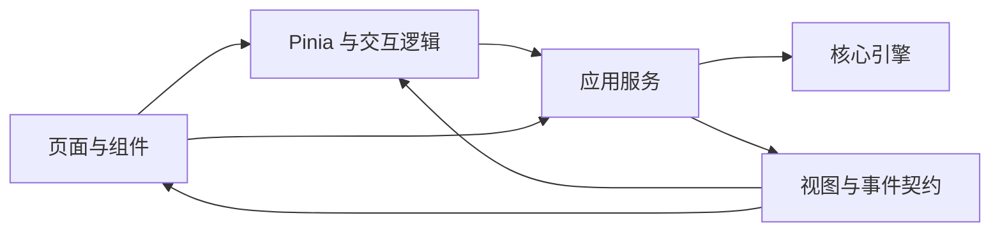

# NovAI UI 协作接口契约设计

## 一、契约目标

NovAI 的前端不是直接操作 Agent 内部对象的薄壳，而是通过明确的应用服务使用核心能力。接口契约要解决三个问题：

- 让界面使用面向业务的动作、视图和事件，而不是理解文件句柄、模型视图和工具运行时。
- 让核心引擎能够独立演进，不把内部重构扩散到 Vue 组件。
- 让会话、确认、队列和文件变更有清晰的归属，避免界面各自维护一套业务真相。

应用通过核心包公开的服务与类型入口协作。核心包保持 UI 无关，不引入 Vue、Pinia 或组件状态；应用不直接访问核心内部模块，也不使用 Node 文件系统。

## 二、分层与依赖方向

| 层级 | 职责 | 依赖约束 |
| :-- | :-- | :-- |
| 页面与组件 | 渲染、收集输入、展示确认与变更 | 可以触发服务动作，不承载 Agent 业务流程 |
| Pinia 与交互逻辑 | 保存当前项目、会话、消息、设置和加载状态；订阅并归并事件 | 不直接持有目录句柄或模型视图 |
| 应用服务 | 组合核心能力，提供业务动作、持久化调度、事件与视图映射 | 不依赖 Vue、组件或 CSS |
| 核心引擎 | 项目文件、Agent 循环、工具、模型协议、要素与检索 | 内部实现不作为 UI 契约 |

组件通常通过对应 store 使用能力；输入补全这类局部、可取消的交互由 composable 管理。设置页等少量简单场景可以直接调用服务，但仍只能依赖公开服务与视图类型。

## 三、项目运行时边界

项目服务负责创建、选择目录打开、恢复最近项目、关闭、刷新和结构检查，并维护最近项目记录。用户授权得到的目录句柄与完整项目快照留在核心运行时，界面只使用项目标识和稳定视图。

| 界面对象 | 承载内容 |
| :-- | :-- |
| 项目视图 | 标识、名称、文件树和配置等展示信息 |
| 最近项目摘要 | 最近打开项目的名称、时间和内容统计 |
| 文件树节点 | 项目内相对路径、名称、类型与子节点 |
| 文件内容视图 | 路径、格式、正文和更新时间 |
| 项目状态 | 结构检查结果与是否可加载 |

打开项目时，核心可以温和补齐缺失的默认结构。界面不需要理解浏览器目录句柄如何持久化，也不需要直接执行项目修复。

文件服务负责文件树、文本读取、手动保存和重新扫描。用户在内容面板中的手动保存与 Agent 工具写入是两条不同路径：前者直接保存文件，后者还会产生确认、工具事件和会话变更记录。

## 四、设置与环境

设置服务面向**当前小说项目的配置**，提供分组读取与更新，以及模型连接测试和模型列表查询。主对话、Embedding、Rerank、输入补全和联网搜索分别测试；要素管理员的模型与权限覆盖作为独立配置组处理。

环境服务提供同步的浏览器能力检查，首页据此决定是否允许进入应用。项目服务复用同一环境边界，防止在不支持目录访问的环境中进入项目流程。

## 五、Agent 会话契约

Agent 服务是创作协作的主入口，负责多会话、角色、消息收件箱、运行生命周期、确认和变更账本。

### 会话与角色

会话按项目持久化，支持列表、创建、切换、历史分页、重命名和删除。界面使用会话视图与摘要，不接触内部模型视图。每个会话属于主智能体或要素管理员。

主智能体和要素管理员都支持直接对话。主智能体发起委派时，服务创建独立的要素管理员会话并驱动任务；主会话只接收最终汇报，完整工具过程保留在委派会话中，之后可以打开继续交流。会话标识同时也是事件路由与确认归属的依据。

### 消息入队与停止

发送消息采用「先入队、再驱动」的异步契约：

1. 服务把指令、可选引用和文件目标快照写入会话收件箱并保存。
2. 界面立即获得会话标识和最新队列，不等待整轮生成结束。
3. 后台驱动器逐轮消费消息，持续通过事件汇报进度。
4. 排队消息按后续轮次处理；插话消息在当前任务的下一步边界处理。
5. 队列支持编辑、撤回，以及把排队消息改为插话。

停止操作中止当前轮次，保留尚未消费的队列。主会话停止时，进行中的委派也收到停止信号。运行是否结束以服务的运行状态为准，不由某个组件自行推断。

### 事件订阅

服务提供进程内事件订阅，订阅返回取消函数。事件是实时协作协议，不是可重新播放的持久事件流；需要恢复状态时读取会话、队列、确认和账本的当前视图。

| 事件类别 | 传递内容 | 界面用途 |
| :-- | :-- | :-- |
| 运行生命周期 | 开始、完成、失败 | 更新运行状态与错误反馈 |
| 消息 | 完整消息、正文增量、思考增量 | 流式渲染对话 |
| 工具 | 调用与结果 | 展示执行轨迹 |
| 文件 | 结构化变更记录 | 刷新文件、变更面板和统计 |
| 队列 | 当前完整队列快照 | 展示排队与插话 |
| 确认 | 新请求及当前待确认集合 | 展示确认卡和会话徽标 |
| 委派会话 | 新会话摘要 | 将会话加入列表并建立归属 |

事件携带会话标识。聊天 store 将普通事件归并到当前会话，同时全局处理确认与委派会话通知，避免后台会话的进展被误写入当前对话。

## 六、写入确认与变更账本

### 确认

工具权限链决定一次写入是否需要用户确认。需要确认时，Agent 暂停对应动作，服务保存待处理请求并发出事件；界面返回接受或拒绝后，原工具调用才继续。

确认预览覆盖新建、编辑、重命名和删除，提供相应的差异、前后路径或回收站信息。请求按会话隔离，因此主智能体与委派会话同时运行时不会互相答复确认。

### 变更账本

成功的文件工具结果直接携带结构化变更，服务将其追加到会话账本。账本随会话保存，不随模型上下文压缩而丢失。

| 变更 | 记录内容 |
| :-- | :-- |
| 新建 | 文件路径、新内容与差异 |
| 编辑 | 文件路径、前后内容与差异 |
| 重命名 | 原路径与新路径 |
| 删除 | 原路径、回收站位置与删除统计 |

一轮结束时生成该轮的变更摘要，界面按文件聚合并展示差异；会话视图还提供完整、去重的变更清单。账本中的角色归属用于区分主智能体和要素管理员的写回结果。

## 七、其他服务边界

| 服务 | 向界面提供的能力 | 明确不承担 |
| :-- | :-- | :-- |
| 检索 | 索引状态、状态订阅、全量或指定来源重建 | 供组件直接执行语义搜索 |
| 输入补全 | 可取消的前后文续写流、独立连接测试 | Agent 会话和正文生成 |
| 要素整理提醒 | 根据章节与要素变化给出提醒、记录已展示状态 | 自动整理或自动修改要素 |
| 项目运行时 | 核心服务之间共享项目快照 | 作为界面业务状态仓库 |

语义检索是 Agent 的工具行为，界面通过工具事件观察，而不是另建一套前端检索管线。要素整理提醒只把建议交给用户，实际整理由 Agent 完成。

## 八、视图与错误

服务层使用独立视图类型表达项目、文件、设置、会话、消息、队列、确认、变更、索引和环境状态。视图可以映射核心内部结构，但不要求与内部类型一一同构。

错误契约包含错误代码、可读信息、是否可恢复及可选详情，供事件与界面反馈使用。当前仍有部分服务直接抛出底层错误，界面需要保留通用错误兜底，不能假定所有失败都已经细分到稳定错误代码。

## 九、协作不变量

无论内部实现如何调整，以下边界应持续成立：

1. UI 只通过公开服务和视图类型访问核心能力。
2. 目录句柄、项目快照、模型视图和工具运行时留在核心侧。
3. 会话与文件事实是核心状态，界面保存其展示副本，不另建业务真相。
4. Agent 运行采用入队与事件协作，不要求组件等待完整轮次。
5. 确认按会话归属，文件变更来自结构化工具结果。
6. 核心引擎不感知 Vue、Pinia 和具体页面。
