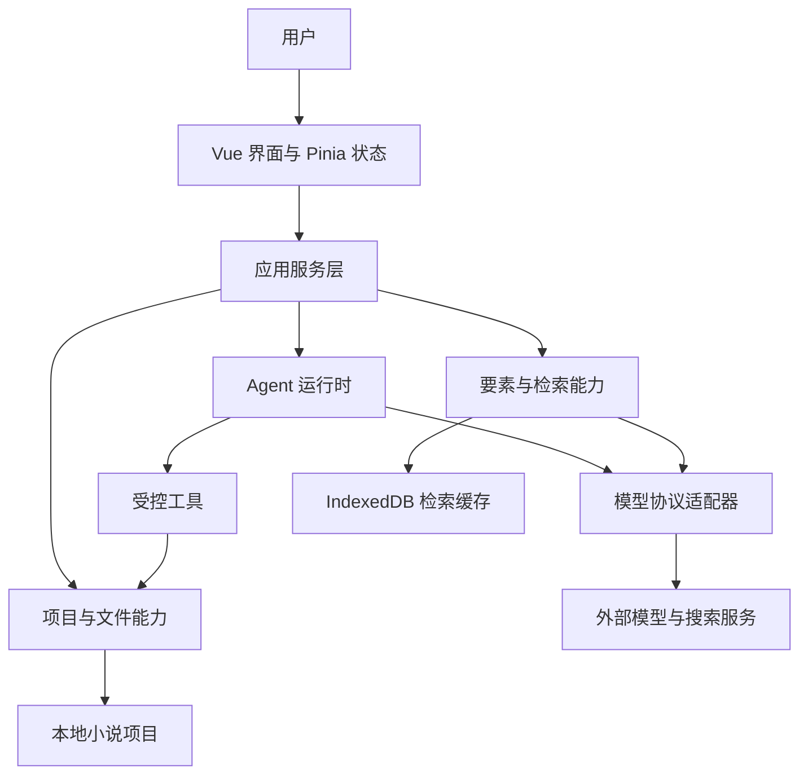

# NovAI 技术架构设计

## 一、架构定位

NovAI 是一个在浏览器中运行的智能体小说创作工具。用户通过对话表达创作意图，Agent 使用受控工具读写本地小说项目；章节、要素和提示词以项目文件为正式载体，聊天界面负责协作、确认和结果反馈。

架构围绕四条边界展开：

1. **项目是文件，不是聊天记录。** 故事资产保存在用户选择的本地目录中，可直接用其他文本编辑器查看。
2. **核心引擎与界面分离。** 核心包不依赖 Vue、浏览器组件或 Pinia；应用通过服务层使用核心能力。
3. **智能体按任务获取上下文。** 文件、要素和检索结果按需进入模型视图，不预先拼装整部小说。
4. **高风险动作受运行时约束。** 工具负责路径、权限、读后写入和确认，不只依赖提示词要求模型自律。

## 二、技术栈

| 维度 | 技术 | 用途 |
| :-- | :-- | :-- |
| 界面框架 | Vue 3、TypeScript、Composition API | 浏览器单页应用 |
| 构建与测试 | Vite、Vitest | 开发、构建和单元测试 |
| 状态与路由 | Pinia、Vue Router | 页面状态与导航 |
| 样式 | Tailwind CSS 4 | 界面样式 |
| 对话输入 | Lexical | 富文本输入、命令和引用节点 |
| 内容展示 | markdown-it、diff | Markdown 渲染与变更对比 |
| 向量检索 | Orama | 情节与时间线的内存向量召回 |
| 持久化 | File System Access API、IndexedDB | 项目文件、最近项目句柄与检索缓存 |
| 模型接入 | 原生网络请求与协议适配器 | 对话、Embedding、Rerank 和输入补全 |
| 工作区 | pnpm monorepo | 分离核心引擎和前端应用 |

应用目前是纯浏览器 SPA，没有 Electron 或 Tauri 壳，也没有集成 Git 版本管理。目录访问能力依赖浏览器支持；不满足运行要求时，首页会给出整页环境提示。

## 三、工作区结构

代码仓库分为两个包：

| 包 | 职责 |
| :-- | :-- |
| `@novai/core` | 与界面无关的引擎、工具、模型客户端、要素体系、检索和服务层 |
| `@novai/app` | Vue 界面、Pinia 状态、路由、编辑器与交互组件 |

核心包按以下领域组织：

| 领域 | 职责 |
| :-- | :-- |
| Agent | 模型视图、轮次循环、上下文压缩、角色、权限和任务委派 |
| 工具 | 文件导航与读写、要素加载、语义检索、联网查询和变更历史 |
| 模型 | 流式请求及多种模型协议的统一适配 |
| 项目与文件 | 项目创建、打开、修复、扫描、会话保存和本地文件访问 |
| 要素与检索 | 要素解析、目录披露、索引构建、向量召回与重排 |
| 服务层 | 将内部能力组合为面向界面的动作、视图和事件 |

核心包以 TypeScript 源码形式被应用消费，只公开根入口、服务层和类型入口。应用不能绕过服务层访问核心内部模块，也不能直接使用 Node 文件系统。详细协作边界见《[UI 协作接口契约设计](UI协作接口契约设计.md)》。

## 四、运行时分层

各层职责如下：

| 层级 | 负责 | 不负责 |
| :-- | :-- | :-- |
| 界面与状态 | 展示项目、对话、确认和文件变更；维护界面交互状态 | 直接访问目录句柄、拼接模型内部消息 |
| 服务层 | 项目生命周期、会话调度、设置、文件与索引操作；映射视图和事件 | 实现界面布局或保存组件状态 |
| Agent 运行时 | 组织模型视图、调用工具、压缩历史、管理队列与角色 | 决定 Vue 组件如何展示 |
| 工具 | 在明确边界内读写项目、检索要素和访问外部资料 | 提供通用 Shell 或整机文件权限 |
| 本地文件与缓存 | 保存创作资产、会话、日志和可重建的检索数据 | 把缓存当作唯一事实来源 |

## 五、项目数据与浏览器存储

一个小说项目由用户可见文件和工具内部文件共同组成：

| 内容 | 位置与格式 | 作用 |
| :-- | :-- | :-- |
| 章节正文 | 章节目录中的文本文件 | 正式叙事内容 |
| 故事要素 | 要素目录中的 Markdown 文件 | 面向 AI 的可维护长期记忆 |
| 提示词与大纲 | 提示词目录中的 Markdown 文件 | 创作人格、项目记忆、要素规范与写作大纲 |
| 项目配置 | 项目根目录的 JSON 配置 | 模型、检索、权限和功能设置 |
| 会话与内部记录 | 项目内部目录 | 对话持久化、日志、回收站和溢出内容 |

浏览器侧还保存两类数据：

- **最近项目目录句柄**：用于在用户授权后恢复项目访问。
- **向量与索引元数据**：按项目隔离，保存在 IndexedDB 中，可从情节和时间线文件重新构建。

项目文件始终是创作资产的事实来源。Pinia 保存当前界面状态；本地存储只承担少量界面或匿名客户端信息，不承担小说正文存储。

## 六、创作与上下文机制

一次创作任务按以下顺序推进：

1. 用户发送自然语言指令，应用建立或恢复对应角色的会话。
2. Agent 将项目记忆、写作大纲、必要的要素目录与当前任务组织为模型视图。
3. 模型在轮次循环中回答或调用工具；需要修改文件时，由权限和确认机制决定是否执行。
4. 工具结果、模型回复和文件变更通过服务层事件返回界面。
5. 需要时压缩较早历史，并将无法直接放入上下文的工具输出保存为可取回的项目内部文件。
6. 会话、故事文件和变更记录分别落盘，供后续继续创作。

系统不自动预选近期章节，也不把所有要素或完整文件树塞入提示词。稳定要素通过目录披露与按需加载提供，情节和时间线通过语义检索提供，章节则通过文件工具按需读取。

主智能体拥有完整创作工具与委派能力；要素管理员使用受限工具维护要素目录。两者既可分别直聊，也可由主智能体发起真实委派会话。角色共用运行时，身份、工具和约束在角色声明中定义。

## 七、模型与外部服务

模型客户端通过协议适配器屏蔽供应商差异，支持 OpenAI Chat Completions、OpenAI Responses、Anthropic 和 Gemini 四类对话协议。流式内容、思考过程和工具调用被转换为统一的 Agent 事件。

不同能力独立配置：

| 能力 | 用途 |
| :-- | :-- |
| 主对话模型 | 创作、理解指令和工具调用 |
| Embedding | 为查询及情节、时间线条目生成向量 |
| Rerank | 对语义召回的候选做二次排序 |
| 输入补全 | 为对话输入框提供可选的续写建议 |
| 联网服务 | 为搜索、网页阅读和知识查询提供外部资料 |

要素管理员可以继承主模型配置，也可以按项目单独覆盖模型与权限档位。

## 八、检索与索引

向量索引只覆盖情节与时间线。人物、地点、实体和世界观使用确定性目录披露与按需加载，章节正文不进入该索引。

检索链路由模型主动发起：Embedding 将查询向量化，Orama 在内存索引中召回候选，可选的 Rerank 负责精排，结果作为工具消息返回模型。IndexedDB 负责跨会话保存向量与元数据，内存 Orama 索引负责当前运行时的快速查询。

写入相关要素后，索引会被标记为过期；用户通过工作区的索引状态入口触发重建。索引模型、向量维度和检索文本模板版本参与兼容性判断。具体机制见《[向量索引与重排序设计](向量索引与重排序设计.md)》。

## 九、可靠性与安全边界

- 文件工具只接受当前项目内的相对路径，限制可处理的文本格式，并保护项目配置和内部目录。
- 修改已有文件前必须先读取，写入前检查文件是否发生变化；新建不能覆盖已有文件。
- 删除通过项目内回收站完成，不直接永久移除故事文件。
- 写权限分为审阅、章节、素材、章节与素材、完全访问五档；确认请求附差异或摘要。
- 过长工具结果采用分页和溢出保存，避免单次结果挤爆上下文。
- Agent 有轮次安全阀、停止信号和用户消息队列，长任务不会脱离界面控制。
- 模型密钥保存在项目配置中，由浏览器直接用于用户配置的服务；不进入应用源码仓库。
