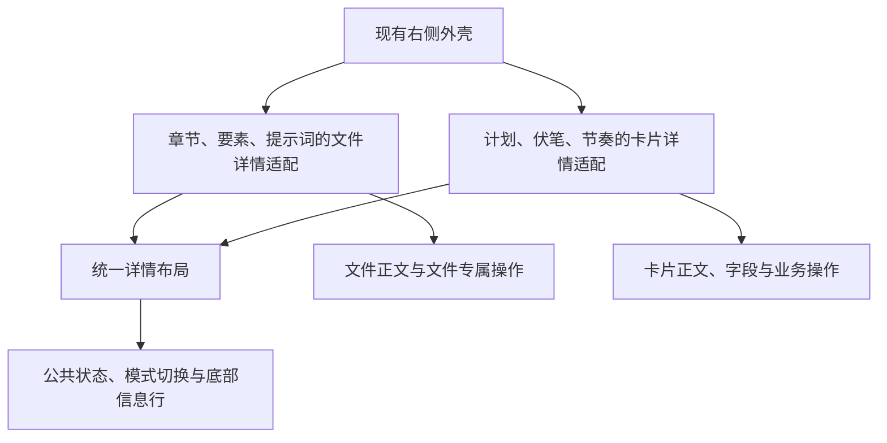

# 六个模块右侧详情布局统一重构计划

## 文档状态

- 记录日期：2026-11-20。
- 当前状态：**施工中；阶段 0（行为基线与布局验收标准）已完成，阶段 1 起待施工**。
- 适用范围：章节、要素、提示词、计划、伏笔、节奏六个模块的右侧查看与编辑详情。
- 本计划承接[《计划页工作区布局统一计划》](计划页工作区布局统一计划.md)、[《正文自动保存与并发冲突交互重设计计划》](正文自动保存与并发冲突交互重设计计划.md)和[《看板卡片详情自动保存与状态操作优化计划》](看板卡片详情自动保存与状态操作优化计划.md)。前两套计划建立的面板归属、保存与冲突能力继续有效，本计划解决它们尚未统一的详情布局与展示组件。

## 一、结论摘要

当前并不是六套完全独立的详情，而是两套详情体系：

| 模块 | 当前详情体系 | 已复用内容 |
| --- | --- | --- |
| 章节、要素、提示词 | 普通文件详情 | 三个模块共用同一实现 |
| 计划、伏笔、节奏 | 看板卡片详情 | 三个模块共用卡片详情骨架，再注入各自字段 |

两条体系已经共用右侧外层容器、头部外框、底层保存会话和冲突差异算法，但**没有共用完整的详情布局**。标题区、保存状态、预览／编辑切换、内容区间距和底部信息行仍分别实现。

本次重构采用一个确定方向：

> 在通用布局目录建立唯一的详情布局，六个模块共同使用；正文与卡片只保留数据、字段和业务操作差异，不再各自拼装头部与底部。

最终不是“卡片模仿正文样式”，而是两者引用同一批布局与展示组件。卡片专用详情骨架在完成迁移后删除，不保留新旧两套入口。

## 二、调研发现

### 1. 已经复用良好的部分

1. **右侧外层已经统一**：六个模块共用同一个面板外壳，宽度、桌面占位、窄屏抽屉、遮罩、拖拽改宽和底部状态栏避让不需要重做。
2. **头部外框已经统一**：两边都使用同一个头部容器，但该容器只提供左右插槽和移动端关闭按钮，不管标题、状态与切换控件。
3. **计划、伏笔、节奏之间已有复用**：三者不是三份完整详情，而是共用卡片骨架并注入不同正文和字段。
4. **保存编排已经共用**：正文和卡片共用同一套保存会话引擎，包括两秒去抖、同键串行、失败补试、冲突代次与恢复核对。
5. **冲突差异算法已经共用**：段落差异、字级高亮、未改动折叠和超限降级使用同一算法。

这些能力应当保留。本次重构不能借“统一”之名再写一套保存引擎，也不应改变右侧外层面板的归属与恢复规则。

### 2. 造成视觉分裂的重复实现

| 区域 | 普通文件详情 | 卡片详情 | 问题 |
| --- | --- | --- | --- |
| 头部左侧 | 只读文件名、保存状态、字数、格式 | 可编辑名称 | 保存状态的位置不同，头部内容分别拼装 |
| 头部右侧 | 一份预览／编辑切换 | 另一份近似切换 | 图标、按钮、提示、禁用与激活样式重复维护 |
| 内容外容器 | 四边留白 | 只有左右留白，顶部与底部由子项补间距 | 同一面板宽度下，纵向节奏不同 |
| 正文表面 | 预览与编辑有统一的外层卡片 | 各领域自行定义边框、留白和滚动 | 计划、伏笔、节奏之间也容易出现细微差异 |
| 底部左侧 | 文件相对路径 | 保存状态及失败重试 | 信息架构不一致 |
| 底部右侧 | 完整本地化时间 | 带“更新于”前缀的月日时分 | 时间格式与间距不一致 |
| 冲突与守护 | 文件版本及文件路径副本 | 卡片字段及新卡片副本 | 业务必须不同，但部分展示结构仍重复 |

因此，上一轮只调整卡片底部文字与颜色，不可能得到真正的布局统一；只要两块模板仍然存在，后续修改还会继续漂移。

### 3. 可以统一，但不能抹平的领域差异

| 模块 | 必须保留的专属能力 |
| --- | --- |
| 章节 | Markdown 正文、字数、选文引用、AI 修改定位与差异重播 |
| 要素 | Markdown 文件编辑、文件格式识别及不可编辑类型限制 |
| 提示词 | 文件正文编辑、草稿恢复、路径副本与重命名迁移 |
| 计划 | 可编辑名称、五种状态、单正文、名称与真实文件名同步 |
| 伏笔 | 六种状态、只读结构信息、读者视角与作者真相双正文、放弃原因确认及默认聚焦 |
| 节奏 | 只读自动状态、计划值控件、实际值对比、节奏意图；不能增加普通状态按钮 |

统一的对象是**区域的位置、间距、控件外观和共同信息**，不是把六种内容强行变成同一个正文输入框。

### 4. 卡片底部可以展示真实路径

计划、伏笔、节奏的摘要和详情数据都已携带项目内相对路径。该路径来自真实文件扫描与详情读取，不是根据标题临时拼接；卡片改名后也会随服务返回的新位置更新。

因此，六个模块的底部可以统一为“真实相对路径 + 更新时间”，无需新增存储字段或修改项目文件格式。

### 5. 当前测试能保护行为，但保护不了布局

现有测试主要覆盖保存状态机、正文组件、面板归属和卡片业务。卡片通用详情及三个领域详情缺少直接的组件级布局测试，因而无法自动发现：

- 保存状态从头飘到尾部；
- 两个体系再次写出不同的预览／编辑按钮；
- 底部路径、时间格式和长路径截断不一致；
- 空状态按钮区仍产生多余顶部占位；
- 插槽迁移后按钮虽然存在，却接到错误事件或被挤出可达区域。

本次必须先补公共布局契约，再迁移现有实现，不能只依赖状态机测试和最终目视。

## 三、目标与固定设计决策

### 1. 总体目标

1. 六个模块共用同一个详情布局组件，统一头部、内容区、底部及滚动责任。
2. 保存状态、预览／编辑切换、底部信息行各只保留一份实现。
3. 通用组件放在布局目录，不依赖任何正文或卡片状态仓库。
4. 领域组件只负责提供数据、业务字段和操作事件，不再自行拼装公共布局。
5. 自动保存、编辑现场恢复、冲突处理、守护和伏笔放弃等行为不得因布局迁移退化。

### 2. 最终布局规格

| 区域 | 六个模块的统一规则 | 可保留的领域差异 |
| --- | --- | --- |
| 头部主区 | 标题在左，保存状态紧随其后；预览／编辑在右；窄屏关闭入口仍由公共头部承载 | 文件标题只读，卡片标题可编辑；正文可显示字数与格式 |
| 保存状态 | 固定位于头部，不再出现在卡片底部；统一为“已保存／等待保存／正在保存／保存失败／保存冲突” | 无 |
| 状态外观 | 已保存为浅灰，等待保存为琥珀并带圆点，正在保存为蓝色，保存失败为红色，保存冲突为琥珀；状态灯只表达状态，不混入业务操作 | 无 |
| 辅助信息 | 位于公共头部的元信息槽；空间不足时优先隐藏字数、格式等辅助信息，标题允许截断，保存状态与模式切换始终可见 | 普通文件可显示字数、格式，卡片无此信息 |
| 消息区 | 位于头部下方、领域工具栏上方，统一承担恢复、守护、冲突和错误提示的占位与间距 | 提示文案、可用出口和副本语义仍由领域决定 |
| 领域工具区 | 位于消息区下方；没有内容时不渲染容器，不占顶部空间 | 计划与伏笔放状态按钮，节奏可放只读状态，普通文件可为空 |
| 主内容区 | 统一四边留白、纵向间距、最小高度与滚动边界；页面级滚动只能有一个责任方 | 正文、双正文、表单及只读字段由领域插槽提供 |
| 普通正文表面 | 单正文的预览与编辑使用同一套边框、背景、内边距和滚动容器规格 | 伏笔作者真相保留警示色；节奏计划值等业务表单保留自身控件 |
| 底部信息行 | 固定位于主内容之后；左侧为项目内真实相对路径，右侧为完整本地化更新时间；左右均不承载保存状态 | 无 |
| 长路径与窄屏 | 左栏可压缩并省略，悬停可读完整路径；右栏不缩水；底部不得横向撑破面板 | 无 |
| 冲突展开 | 继续接管主内容区，常规领域工具区与底部信息行隐藏；返回后恢复原布局 | 文件按整份正文比较，卡片按字段比较 |
| 未选择内容 | 标题保留“内容预览”，隐藏保存状态、模式切换和整个底部，显示原有空状态提示 | 已选文件或卡片但正文为空时仍显示完整详情、保存状态和底部 |

时间统一沿用普通文件当前的完整本地化日期时间，不使用卡片当前的短格式，也不额外添加“更新于”前缀。

### 3. 交互行为保持不变

1. 普通自动保存成功后保持当前编辑状态，不自动跳回预览。
2. 正文与卡片继续使用两秒自动保存、同键串行和已有生命周期收口；不新增保存按钮。
3. 保存失败仍提供原因与重试，但重试不再依附卡片底部状态灯；统一由头部下方的消息区承载，正文原有的“放弃更改”一并保留。消息出现和消失只重新分配主内容剩余高度，不产生页面级双重滚动，不清空输入、移动光标或让底部失去可达性。
4. 冲突仍以非阻塞提示和主动展开比较为主，四种出口及有损操作二次确认不变。
5. 文件副本使用路径，卡片副本创建新卡；两者不能为了界面统一而改成同一种存储操作。
6. 正文切换文件后的预览恢复、卡片跨切卡与重开后的编辑模式恢复，继续按各自现有规则执行。
7. 伏笔从详情或拖入已放弃列进入操作态时，原因输入仍默认聚焦；未确认不放弃，确认仍原子提交状态、原因和落点。
8. 计划与伏笔普通状态仍遵循“已生效状态”和“待保存状态”分离；看板拖拽仍立即落盘，不改成详情两秒保存。
9. 右侧面板继续由现有外层统一控制，正文跨分类保挂载、卡片按领域显示和项目切换隔离均不改变。
10. 卡片详情继续不提供删除入口，本计划不恢复删除功能。
11. 删除／重命名守护期间，保存状态仍沿用现有普通保存口径：写盘在途优先显示“正在保存”，其余按冲突、失败、待保存、已保存显示。守护的冻结原因与处理出口由消息区解释，不在状态灯新增第六种状态；写盘期间发生守护时，仍以会话实际结算结果更新状态。

## 四、目标代码结构

### 1. 组件职责



公共布局只接收展示数据、发出用户事件并提供插槽，不读取项目、文件或卡片状态仓库，不直接调用保存服务。

### 2. 公共组件清单

| 公共组件 | 职责 | 不负责的内容 |
| --- | --- | --- |
| 统一详情布局 | 组合公共头部、消息区、领域工具区、主内容和底部；统一留白与滚动边界 | 保存编排、领域字段、冲突业务 |
| 保存状态灯 | 将五种保存阶段映射为唯一文案、颜色与圆点 | 判断草稿是否脏、执行保存或重试 |
| 预览／编辑切换 | 当前模式、激活态、图标、提示、禁用原因和切换事件 | 决定模式何时改变、保存后跳转到哪里 |
| 底部信息行 | 相对路径、完整时间、长路径省略与窄屏防溢出 | 推导或伪造路径、执行文件操作 |
| 普通正文表面 | 为单正文预览／编辑提供一致容器与间距 | 持有正文草稿或替换领域编辑器 |
| 冲突处理布局 | 统一冲突说明、内容比较区、副本表单区和四个出口的相对位置与二次确认交互 | 计算领域差异、执行采用或创建副本 |
| 差异块与守护横幅 | 复用现有差异算法并统一差异块、折叠、守护提示的展示结构 | 决定文件／卡片字段及守护业务去向 |
| 卡片详情展示适配器 | 单独承接三类卡片共用的状态工具、字段比较、卡片副本表单及界面事件状态 | 读取卡片仓库、保存文件或包含正文布局 |

**卡片共用展示能力的承接关系**：旧卡片骨架中的冲突字段比较、守护横幅、新卡副本表单、两击确认和表单开关迁入上述公共展示组件及卡片展示适配器。卡片展示适配器与统一详情布局组合使用，但不包含头部、底部或正文布局。两击确认、表单开关和展开折叠属于界面状态，可由展示组件持有；实际保存、探测、采用、副本创建和清理由原调用方负责。切换卡片、展开或收起冲突时，继续清理确认态与副本表单；多个长字段的折叠标识继续隔离。

现有头部外框继续作为统一详情布局的内部构件，不再另建一个与它平行的头部。

### 3. 统一详情布局的插槽与输入输出

公共布局至少接收：当前模式、是否存在已选内容、保存阶段、相对路径、更新时间、是否允许编辑及禁用原因。领域提供标题插槽、可选元信息和主内容；布局自身只发出关闭与模式切换事件。标题、消息、工具、正文及冲突插槽中的业务操作继续由原事件链接管，不要求所有事件都经过布局转发。

保存阶段使用布局层统一定义的五态展示类型。普通文件与卡片各自把自己的会话状态转换为这五态，不把两套会话对象或领域状态类型传入公共组件。两边均按“写盘在途、存在冲突、普通失败、存在待保存内容、已保存”的优先顺序派生，遵守前述守护口径。

保存状态文案另设集中映射并附完整测试。公共布局负责把状态灯放在头部；普通文件与卡片只提供阶段，不再分别拼接文案或颜色。

| 插槽 | 内容 |
| --- | --- |
| 标题 | 文件只读名称或卡片可编辑名称 |
| 头部元信息 | 字数、格式等可选辅助信息 |
| 消息 | 恢复、守护、冲突与普通失败提示及操作 |
| 领域工具 | 状态按钮、只读状态或其他领域级工具 |
| 主内容 | 文件正文、计划正文、伏笔双正文、节奏字段等 |
| 冲突比较 | 展开后的领域版本比较；存在时替代常规主内容与底部 |

预览／编辑切换和底部信息行不再作为插槽交给各领域重写，而由统一详情布局固定组合。

### 4. 施工落点与旧机制去向

| 位置 | 处理方式 |
| --- | --- |
| `components/layout/` | 新增统一详情布局、保存状态灯、预览／编辑切换、底部信息行及必要的共享类型 |
| `components/layout/PanelHeader.vue` | 保留并由统一详情布局复用，不复制其外框和关闭逻辑 |
| `components/layout/FilePanelBody.vue` | 保留正文会话、AI 定位、选文引用和文件专属操作；删除独立状态灯、切换控件与底部模板，接入统一布局 |
| `components/card-board/DetailPanel.vue` | 将头部、底部与内容布局迁入统一详情布局；将卡片共用冲突、守护、副本表单迁入明确的展示组件和卡片展示适配器；六个模块迁移完成且测试通过后**删除文件**，不留兼容壳 |
| `components/plan/detail-mode.ts` | 通用视图模式类型迁入布局层；调用方全部切换后删除旧文件 |
| 三个领域详情组件 | 保留为薄适配层，负责卡片字段、状态操作与事件转发，不再决定公共布局 |
| `views/ProjectView.vue` | 保留现有面板归属与挂载规则，只调整必要的属性与事件接线，不集中接管详情内部布局 |
| 通用保存会话与领域状态仓库 | 本计划原则上不改；若迁移暴露真实缺陷，停止该阶段并登记，不顺手重写 |

### 5. 不做一个“无所不知”的大组件

统一详情布局不得出现“如果是计划就怎样、如果是伏笔就怎样”的领域分支。公共组件只允许理解通用展示概念；领域差异必须通过插槽和明确事件注入。

同时也不能为了消除重复而合并以下机制：

- 文件与卡片的保存身份和草稿结构；
- 文件正文与卡片多字段的冲突数据模型；
- 文件路径副本与卡片新卡副本；
- 普通文件编辑会话与卡片编辑会话的恢复规则；
- 计划、伏笔、节奏各自的状态与字段语义。

## 五、分阶段施工

### 阶段 0：冻结行为基线，建立布局验收标准

#### 任务

- [x] 核对施工工作区，保留尚未提交的“保存后保持编辑态、移除卡片删除入口”改动，不回退、不覆盖；将其中临时性的卡片底部样式调整视为本重构的待替代实现。（2026-11-20 核对：遗留改动共 9 个产品文件 + 文档子模块，内容与预期一致——`shouldReturnToPreviewAfterSave` 及其 watch 已删、卡片删除入口已从骨架/三领域/ProjectView 拆除、卡片底部已套用正文信息行规格。全部保留。）
- [x] 记录六个模块在预览、编辑、等待保存、保存失败、冲突、守护和空状态下的现有行为。（见下方「六模块行为基线事实表」）
- [x] 为当前卡片详情及三个领域详情补组件级测试，先证明标题、状态、模式切换、领域操作和冲突出口确实接到正确事件。（新增 4 份 spec 共 34 用例：`DetailPanel.spec.ts` 14、`PlanDetailPanel.spec.ts` 5、`ForeshadowingDetailPanel.spec.ts` 9、`RhythmDetailPanel.spec.ts` 6；只断言业务接线与事件，不断言状态灯位置等将被替换的布局。）
- [x] 建立六个模块共用的事实表：标题形态、真实路径来源、时间来源、保存阶段来源、模式来源和滚动责任。（见下方事实表）
- [x] 将“保存状态在头部、底部为路径与完整时间”登记为可执行验收项；统一布局建立后转为组件结构断言，避免最终验收只看截图文字。（登记为阶段 1/2 的组件结构测试义务：保存状态灯组件必须被统一布局的头部组合渲染、底部信息行组件断言左路径右完整时间；旧骨架基线测试刻意不写位置断言，避免把「状态在底部」固化。）

#### 六模块行为基线事实表（2026-11-20，旧实现实测）

| 事实项 | 章节 / 要素 / 提示词（FilePanelBody） | 计划 / 伏笔 / 节奏（卡片 DetailPanel 骨架） |
| --- | --- | --- |
| 标题形态 | 只读 `h2` 文件名（truncate），标题后紧跟状态灯、字数、格式 | 可编辑 `input`（守护时 readonly） |
| 保存状态位置 | 头部（标题右侧） | 底部左侧（遗留改动已套正文规格，仍是待替代实现） |
| 保存阶段来源 | `editorSessionPhase` 派生：saving > conflict > failure > dirty(等待) > clean | store `savePhase`：inFlight > conflict > failure > 非空草稿(pending) > clean |
| 状态文案 | 正在保存/保存冲突/保存失败/等待保存/已保存（同一套文案，两处实现） | 同文案，独立实现；失败附带底部「重试」按钮 |
| 模式切换 | 头部右侧分段控件（预览/编辑）；不可编辑类型禁用编辑按钮并给解释 tooltip | 头部右侧同规格分段控件；无禁用态需求 |
| 模式来源 | 组件本地 `viewMode`（切文件/项目重置 preview；locateToken 强制回预览） | store `detailMode`（随卡片编辑会话恢复，重开回编辑现场） |
| 底部左侧 | `file.path`（真实相对路径，无省略处理） | 保存状态 + 重试（**路径未展示**；`sourcePath` 已在卡数据中可用） |
| 底部右侧 | `toLocaleString('zh-CN')` 完整本地化时间 | 「更新于 + 月/日 时:分」短格式 |
| 预览表面 | 统一卡片：`rounded-lg border bg-gray-50 p-4` 内部滚动 | 各领域自定（计划/意图 `rounded-md px-3 py-2`，双正文分栏 h-[calc] 截断） |
| 内容区外距 | `p-4` 四边留白 | `px-4` 左右留白，顶部间距由子项 `mt-2/pt-3` 补 |
| 空状态 | 标题「内容预览」；隐藏状态灯/切换；居中提示（含 AI 删除 notice） | 卡片详情必挂在 activeCard 上，无空状态分支 |
| 冲突紧凑条 | 消息区琥珀条「比较两个版本」 | 列按钮下方琥珀条「比较并处理」（testid `*-detail-conflict-compare`） |
| 冲突展开 | 整页替换内容区：说明+探测/缺失/不可读三态+单栏差异块+副本表单+四出口 | 同结构整页替换：短字段红绿并排 + 长字段差异块 + 四出口（两击确认） |
| 守护横幅 | 删除：恢复为草稿副本（路径表单）/放弃并关闭；重命名：迁移草稿/放弃并打开新文件 | 删除：恢复为新卡片（名称表单）/放弃并关闭；重命名展示新位置；标题冻结 |
| 失败出口 | 编辑区内红框：重试 + 放弃更改 | 底部状态灯内联「重试」；原因在 `actionError` 一行 |
| 滚动责任 | 预览/编辑卡片内部 `overflow-y-auto`；冲突比较区内部滚动 | 领域正文各自滚动；内容区不整体滚动 |

#### 阶段门禁

- 新增组件测试在旧实现上能准确描述保留行为；对即将删除的旧布局只断言业务接线，不把错误位置固化成新规范。✅（34 用例全绿，无位置断言）
- 全量测试、应用组件测试、类型检查通过。✅（全量 117 文件 1413 用例；组件 14 文件 116 用例；`tsc --build` 干净）
- 本计划更新阶段状态、实际测试数量和发现的偏差。✅（见施工日志；无计划外偏差）

### 阶段 1：抽取公共控件与统一信息口径

#### 任务

- [ ] 新建保存状态灯，统一五种阶段的文案、颜色、圆点、可读名称和测试标识规则。
- [ ] 新建预览／编辑切换，保留文件不可编辑时的禁用与解释，保留卡片所需事件和可访问名称。
- [ ] 新建底部信息行，统一相对路径、完整时间、长路径省略与右栏不缩水。
- [ ] 将通用预览／编辑类型迁入布局层，更新正文与卡片引用。
- [ ] 新建普通正文表面，只统一容器，不接管输入状态。
- [ ] 分别用组件测试覆盖五种保存状态、两种模式、禁用原因、路径截断和时间显示。
- [ ] 抽取两域共用的差异块、冲突处理布局与守护展示结构，保留各自副本文案、出口和业务事件。
- [ ] 明确卡片展示适配器的组合方式，承接三类卡片共用字段比较、表单及二次确认，不复制到三个领域组件。

#### 阶段门禁

- 公共组件不导入任何领域状态仓库，不包含模块名称判断。
- 全量测试、应用组件测试、类型检查通过；本阶段只建立组件，不让新旧控件同时出现在同一详情中。

### 阶段 2：建立统一详情布局并迁移普通文件

#### 任务

- [ ] 在布局目录建立统一详情布局，组合现有头部外框和阶段 1 的公共组件。
- [ ] 统一消息区、领域工具区、主内容区、冲突比较区与底部的显示顺序和间距。
- [ ] 将普通文件详情接入统一布局；保存状态仍在头部，底部保持真实路径和完整时间，正文行为不变。
- [ ] 保留正文选文引用、AI 修改定位、差异重播、不可编辑类型、快捷保存、恢复与守护出口。
- [ ] 保留正文组件对外的脏态与自动定位快照接口，避免项目视图因迁移失去既有能力。
- [ ] 验证未选择文件、已选但正文为空、无工具区、无元信息和冲突展开时不留下多余空白；未选择文件时隐藏状态、模式切换和底部。
- [ ] 验证失败消息出现前后主内容重新分配剩余高度，长文仍可滚动到底，光标和底部可达，不产生第二个页面级滚动容器。

#### 阶段门禁

- 普通文件不再包含自己的保存状态灯、预览／编辑按钮或底部信息行模板。
- 普通文件组件的自动保存、保存身份、冲突与归属测试全部保留并通过。
- 全量测试、应用组件测试、类型检查和应用构建通过。
- 浏览器抽查章节、要素、提示词，确认迁移未破坏编辑、滚动和头部信息。

### 阶段 3：迁移计划、伏笔、节奏，删除卡片专用骨架

#### 任务

- [ ] 三个领域详情改用统一详情布局，复用同一保存状态灯、模式切换和底部信息行。
- [ ] 将卡片真实相对路径接入底部，卡片改名后路径随最新详情更新。
- [ ] 将卡片保存状态移入头部，删除卡片底部保存状态及重试按钮；失败原因与重试移入公共消息区。
- [ ] 统一计划单正文的预览／编辑表面、四边留白和滚动边界；保存成功继续停留编辑态。
- [ ] 保留伏笔结构信息、双正文、作者真相警示色与放弃操作态；操作态聚焦由领域组件继续负责。
- [ ] 保留节奏计划值、实际值与意图正文；无状态工具内容时不渲染空工具区。
- [ ] 将卡片守护、紧凑冲突条、展开比较和副本操作接入公共布局的消息区与冲突插槽；卡片展示适配器承接共有界面状态，业务事件保持原样。
- [ ] 删除卡片专用详情骨架和旧视图类型文件，清理不再使用的样式、属性、事件与测试代码。

#### 阶段门禁

- 三个卡片详情不再引用卡片专用骨架；该骨架已从代码库删除，其冲突、守护、副本表单和二次确认均有测试覆盖的新承接方。
- 六模块都渲染同一个保存状态灯、同一个预览／编辑切换和同一个底部信息行。
- 卡片名称、正文、状态、伏笔放弃、节奏控件与冲突出口的组件测试通过。
- 全量测试、应用组件测试、类型检查和应用构建通过。

### 阶段 4：六模块真机对照与收口

#### 布局对照

- [ ] 依次打开章节、要素、提示词、计划、伏笔、节奏，逐项对照头部顺序、状态灯、模式切换、内容留白、底部路径与时间。
- [ ] 对六个模块分别检查预览与编辑；文件不可编辑类型只禁用编辑，不错误影响卡片。
- [ ] 检查长标题、长路径、长正文、空正文、状态按钮换行、冲突长文和错误提示。
- [ ] 检查面板宽度 240、320、720 像素，以及 1440、1280、1024、900、480、375 像素视口；没有整页横向溢出、双重页面滚动或不可达操作。
- [ ] 1280 及以上桌面继续实际占位，1024 及以下继续按现有窄屏抽屉规则；底部状态栏不被遮挡。

#### 行为回归

- [ ] 正文与计划各输入一段，验证等待保存、正在保存、已保存都在头部同一位置，停止两秒后真实落盘且仍停留编辑态。
- [ ] 保存期间继续输入，旧成功回执不清掉新内容；快速切文件、切卡和切分类后内容不串台。
- [ ] 构造普通失败，检查头部状态、消息原因、重试及正文放弃出口；消息出现前后编辑光标可达、长文可滚动到底、底部仍可达，恢复后状态和路径正常更新。
- [ ] 构造外部修改，检查紧凑冲突提示、展开、返回、再进入、四种出口与二次确认；文件和卡片各自副本语义不变。
- [ ] 验证删除／重命名守护、刷新恢复和卡片改名后的真实路径更新。
- [ ] 验证计划普通状态、伏笔普通状态与双正文、伏笔取消／确认／拖入放弃、节奏全部编辑控件。
- [ ] 验证正文选文引用、AI 多处差异定位与重播、快捷保存，以及卡片预览双击进入编辑。

#### 验证边界

- 使用用户常驻的 `http://localhost:5173`，不另起重复服务。
- 使用 OPFS 隔离项目副本，真实 `~/note/test-novel` 零改动；测试密钥不得写入仓库，临时种子使用后删除。
- 自动保存和落盘以 OPFS 实际文件为准，不能只看状态灯。
- 合成事件可以验证应用处理链，但真实鼠标拖拽、物理键盘和中文输入法必须由真人复核，不能宣称自动化替代通过。
- 测试结束清理 OPFS 内容、最近项目测试记录、正文与卡片两套浏览器恢复草稿、临时种子和测试标签页，并在 OPFS 方案文档追加使用记录。

#### 最终门禁

- 全量测试、应用组件测试、类型检查、应用构建全部通过。
- 六个模块布局对照与本地行为回归完成；未实测项明确列出，不用状态机测试冒充真机视觉验收。
- 本计划、当前进度、旧计划后续指向与 OPFS 使用记录已同步。

## 六、新旧机制替代表

| 项目 | 旧机制去向 | 最终机制 |
| --- | --- | --- |
| 正文头部状态灯 | 删除重复模板 | 布局目录唯一保存状态灯 |
| 卡片底部状态灯 | 删除 | 同一保存状态灯固定位于头部 |
| 两份预览／编辑切换 | 全部替换 | 布局目录唯一切换组件 |
| 正文与卡片各自的底部 | 全部替换 | 统一“相对路径 + 完整时间”信息行 |
| 卡片专用详情骨架 | 完成迁移后删除 | 六模块共用统一详情布局 |
| 计划目录中的通用模式类型 | 迁出并删除 | 布局层共享类型 |
| 领域字段与操作 | 保留并接入插槽 | 各领域薄适配层 |
| 现有右侧外壳与头部外框 | 保留 | 继续统一承载，不重复建设 |
| 通用保存引擎与差异算法 | 保留 | 不改保存语义，继续复用 |

施工过程中允许阶段内短暂存在适配代码，但每个阶段必须明确下一步删除对象；最终不得保留新旧详情骨架并行、旧组件转发新组件的永久兼容层或无人使用的重复样式。

## 七、自动化验收要求

### 1. 公共组件结构测试

1. 五种保存阶段的文案、颜色、圆点和状态位置一致。
2. 模式切换的激活态、禁用态、提示、图标和事件参数正确。
3. 底部路径与时间来自传入数据；长路径省略不挤压时间，不伪造地址。未选择内容时隐藏整个底部，已选但正文为空时仍显示真实路径与时间。
4. 统一详情布局固定渲染头部、主内容和底部；无消息、无工具、无辅助信息时不留空占位。
5. 冲突展开时隐藏常规工具与底部，收起后恢复；不能同时出现两套主内容。
6. 主内容承担内部滚动，消息出现或收起后重新分配剩余高度；底部不随长正文滚出，页面级不出现双重纵向滚动。

### 2. 领域接线测试

1. 文件标题、字数、格式、可编辑限制与路径正确。
2. 卡片标题输入、三种领域的模式事件、保存重试和真实路径正确。
3. 计划与伏笔的已生效状态、待保存状态不混淆；节奏不出现普通状态切换。
4. 守护时标题与领域输入的冻结规则不变。
5. 伏笔操作态在“挂载即存在”和“后续进入”两种路径下都聚焦原因输入。
6. 冲突两种采用操作第一次只进入确认，第二次才发出事件；切换对象或收起后清确认态。
7. 普通保存成功保持编辑态；写盘期间继续输入和切卡后的恢复行为不变。
8. 文件与卡片的守护恢复副本、放弃守护、副本命名、空名禁用和取消均接到原业务事件；切换对象、展开或收起冲突后，副本表单与确认态按原规则清理。
9. 长字段差异的展开／收起不串字段，正文与卡片继续复用同一差异算法和差异块展示。

### 3. 必跑命令

```bash
pnpm test
pnpm --filter @novai/app exec vitest run src/components
pnpm typecheck
pnpm build
```

根测试命令不会收集全部组件规格测试，因此两条测试命令都必须执行，不能只报全量状态机测试数量。每个阶段记录实际通过数量；构建警告与失败分开报告，不把既有警告写成构建失败。

## 八、明确不做

1. 不重写或合并正文与卡片的保存引擎、恢复镜像和变更反馈链。
2. 不改变两秒自动保存、普通失败补试、生命周期收口和保存后保持编辑态的既定行为。
3. 不把章节、要素、提示词、计划、伏笔、节奏压成同一种正文编辑器。
4. 不统一文件与卡片的冲突数据模型、副本存储语义和守护出口。
5. 不恢复卡片删除入口，不调整看板拖拽、排序、回收站与 AI 工具协议。
6. 不调整对话模块、设置弹窗、新建面板和 AI 写入确认面板；它们可继续复用现有外壳，但不属于六模块详情布局的本次迁移范围。
7. 不重建右侧外层容器，不改变面板宽度偏好、桌面占位与窄屏抽屉断点。
8. 不引入新 UI 框架、新图标库、新设计系统或全局视觉改版。
9. 不顺手修复调研中发现的保存边缘问题；若影响本计划验收，记录复现步骤、用户影响并另行决策。
10. 不迁移项目文件、卡片内容、路径格式或本地配置，本重构没有数据格式迁移。
11. 不推送远程仓库。

## 九、文档、工作区与提交纪律

1. 开工前重新读取本计划和三份直接承接的旧计划；旧方案与后续施工日志冲突时，以当前代码、最新明确交互和最终施工日志为准。
2. 当前工作区已有上一轮未提交修改，文档子模块也存在其他未提交改动。施工只能处理本计划明确涉及的文件，不覆盖、不回退、不混入无关改动。
3. 本计划涉及布局目录中的共享组件。正式动工前列出实际共享文件清单并取得许可；计划审阅通过不等于自动批准所有共享文件修改。
4. 每阶段门禁更新本计划状态、任务清单和施工日志，记录日期、阶段、实现内容、测试数量、真机结论、偏差与用户影响。
5. 阶段施工中发现计划外问题，先写入施工日志，不随手扩大范围。
6. 结项时同步当前进度，并在《计划页工作区布局统一计划》和《看板卡片详情自动保存与状态操作优化计划》中增加后续统一布局的指向，避免旧底部设计继续误导施工。
7. 文档随门禁写盘，结项统一提交；文档子模块先提交，再推进父仓库指针。
8. 未使用 goal 指令时，完成代码后等待用户明确批准再提交；使用 goal 指令时按完整阶段门禁提交，一个逻辑单元一个提交。
9. 提交信息遵循 `type(scope): 中文说明`，不推送。

## 十、施工日志

### 2026-11-20：深度调研与计划成稿

- 核对六个模块的详情入口、外层容器、头部、模式切换、正文容器、底部信息行及卡片路径数据链。
- 确认实际分裂点是“普通文件详情”和“卡片详情”两套体系，而不是六个模块各自完全独立。
- 确认保存引擎与冲突差异算法已共用，本次重构应集中在布局和展示层。
- 确认卡片已有真实项目内相对路径，可统一底部信息，不需要修改文件格式。
- 确认卡片详情缺少直接组件测试，新增布局契约与领域接线测试是迁移前置条件。
- 独立定稿审查后补全旧卡片骨架中冲突、守护、副本表单与二次确认的承接方；固定未选择内容、守护状态、失败消息高度与滚动、测试恢复数据清理规则。
- 本阶段只完成调研和计划文档，未修改产品代码，未运行产品测试或真机验收。

### 2026-11-20：计划定稿

- 用户确认调研结论与重构方案，计划正式定稿。
- 后续施工按阶段 0 至阶段 4 执行；动工前仍须按仓库规则确认共享文件改动清单。
- 当前未开始代码施工，未提交本计划或索引变更。

### 2026-11-20：阶段 0 施工（行为基线与布局验收标准）

- 核对工作区遗留改动（保存后保持编辑态 + 移除卡片删除入口，9 个产品文件）：与计划描述一致，全部保留不回退；其中卡片底部样式调整按计划视为待替代实现。
- 新增 4 份组件基线测试（34 用例）：卡片骨架 `DetailPanel.spec.ts`（标题/模式/状态按钮/五阶段文案/两击确认/副本表单/守护出口/折叠隔离/切卡清理）、计划/伏笔/节奏三份领域 spec（领域事件 + 伏笔操作态双路径聚焦 + 节奏无状态按钮约束）。只断言业务接线，不固化即将替换的布局位置。
- 建立六模块行为基线事实表（已并入阶段 0 任务区）：确认保存阶段派生口径两侧一致（在途>冲突>失败>待保存>已保存）、卡片 `sourcePath` 可直接接底部、卡片当前时间格式（月日时分 + 「更新于」）与正文完整格式不一致。
- 门禁：全量 117 文件 / 1413 用例通过；应用组件 14 文件 / 116 用例通过；`pnpm typecheck` 干净。
- 偏差：无。发现的既有事实（卡片底部无路径、时间短格式）即本计划要修的对象，不属偏差。
- goal 指令开工：按 AGENTS.md goal 规则，阶段门禁处直接提交；计划 §九.3 的「共享文件清单取得许可」以 goal 指令对整份计划（含 §四.4 施工落点表）的批准为许可，涉及共享文件为 `components/layout/`（新增公共组件 + 修改 `FilePanelBody.vue`，`PanelHeader.vue` 仅复用不改）。
