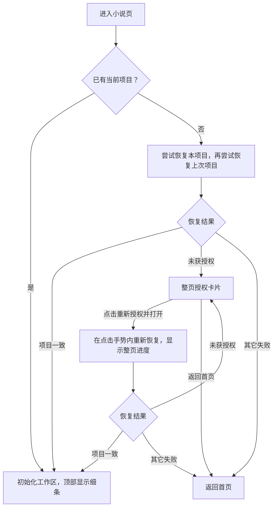

# 项目打开进度与移动端授权修复计划

> 状态：已完成（2026-11-23 定稿、施工并验收，四阶段施工日志见文末）
> 来源：2026-11-23 手机真机排查（Android Chrome 157，USB 连接）——恢复项目约 30 秒零反馈、浏览器重启后自动恢复出现红色英文报错、递归删除失败；四项体验取舍已由用户在会话中拍板

## 施工日志

（施工时按「日期 + 阶段 + 提交 hash + 验收结论 + 偏差记录」追加。）

**2026-11-23 · 阶段 1 核心层**（未提交，等用户审查）

- 落地：`types/project.ts` 新增 `ProjectLoadPhase` / `ProjectLoadProgress` / `ProjectLoadReporter`；`core/fs/project-fs.ts` 的 `createProject` / `inspectProject` / `repairProject` / `loadProjectFromHandle` / `scanDirectory` 接入上报，导出步数常量 `STRUCTURE_STEP_COUNTS`（体检 9、修复 17、创建 18、读取 3）；`services/project-service.ts` 四个打开类动作接收 `ProjectLoadOptions`，报「等待授权」与「即将完成 1/2、2/2」，打开项目的结构阶段按 0/9 起点拼成 29 步；`core/project/recent-projects.ts` 的权限查询与请求抛异常一律返回「未获授权」；新增 `core/fs/remove-directory.ts`（`removeDirectoryEntry` / `removeDirectoryTree`），删除技能与删除项目目录两处改用。
- 验收结论：`pnpm exec vitest run packages/core` 96 个文件 1251 条全绿（施工前 93 个文件 1211 条，新增 3 个文件 40 条）；`pnpm --filter @novai/core typecheck` 通过。新增测试覆盖：各段步数与路径序列、接续段不重复报起点、扫描计数逐条加一并与文件树一致、四个动作的完整事件序列及「保存记录 → 1/2 → 写日志 → 2/2」的先后关系、未获授权时抛类型化错误且不修复结构、手机模式下删除技能与删除项目目录都删干净。
- 偏差记录：
  1. `removeDirectoryTree` 在计划的三条规则之外多一步保险：逐项清空后先调不带参数的 `remove()`，若它拒绝目录，再对已清空的目录重试一次递归删除。原因是手机版 Chrome 上「空目录的 `remove()`」没有单独实测过（只实测过 `removeEntry` 删空目录正常），阶段 4 真机验收时确认实际走的是哪一步。
  2. 「移除项目并删除本地目录」拿不到授权时仍是红色错误、提示文案不变（与「明确不做清单」一致）。唯一的差别来自第二节「授权失败不再上抛」：浏览器直接抛异常（而不是返回拒绝）时，原来显示英文异常，现在显示同一条中文提示「没有获得项目目录读写权限，已取消删除本地目录。」。
  3. 核心包的 `tsconfig` 不包含测试文件（既有配置，未改动），所以类型检查不覆盖测试。本次对改动到的 5 个测试文件用同一套编译选项单独跑了一遍类型检查并修正了发现的问题。

**2026-11-23 · 阶段 2 应用层状态**（未提交，等用户审查）

- 落地：新增 `utils/project-load-progress.ts`（阶段区间 0–3/3–33/33–83/83–90/90–100、`toLoadProgressView`、`resolveProjectEntryOutcome`）与 `composables/use-delayed-flag.ts`（300 毫秒延迟置真，作用域销毁清理）；`stores/project.ts` 增加 `loadProgress` / `isOpenLoading` / `isWorkspaceLoading` / `consumePendingWorkspaceInit` / `setWorkspaceLoading`，四个打开类动作接入进度（开始即置「等待授权」，60 毫秒节流且最后一次更新生效，阶段切换不节流），进度归属用独立令牌（旧动作晚到的事件被忽略、结束不清掉新动作的进度），成功后置「刚完成一次打开」标记，待授权提醒带上 `projectName`。
- 验收结论：`pnpm exec vitest run packages/app` 55 个文件 635 条全绿（施工前 52 个文件 617 条）；`pnpm --filter @novai/app typecheck` 通过。新增测试覆盖：区间换算与边界（缺步数、越界、总量 0 不出 NaN）、恢复结果三分支判定、延迟标志五种时序、进度的开始/清空/换算/节流/归属令牌/一次性标记。
- 偏差记录：
  1. 节流实现第一版在窗口内连发多条事件时未清掉旧计时器，最后一次更新会丢——节流测试当场抓出，已修（设新计时器前先清旧的），测试保留此断言。
  2. 载入工作区阶段不在核心层事件里（小说页用 `isWorkspaceLoading` 表达，见计划 §4），`toLoadProgressView` 的入参类型放宽为接受 `{ phase: 'workspace' }`，区间表保持五个阶段完整——只是让类型如实反映「workspace 也能换算」这个事实，未增加新行为。

**2026-11-23 · 阶段 3 应用层界面**（未提交，等用户审查）

- 落地：新增 `components/project/` 三组件——`ProjectLoadProgress.vue`（panel 卡片 / page 整页两形态，标题与各阶段明细按「已拍死的取舍」第 8 条文案表，实心进度加当前阶段区间流动条纹、`prefers-reduced-motion` 降级为静态）、`ProjectPermissionGate.vue`（整页授权卡片，authorize/back 两事件）、`WorkspaceLoadStrip.vue`（28 像素文档流细条加底边流动线）。`HomeView.vue` 接线：横幅位置在打开类动作超 300 毫秒后换成进度面板（新建动作不占横幅位置，面板只在新建对话框内），进行中新建/打开/恢复/最近卡片及删除按钮全部置灰且各处理函数开头有守卫，新建对话框创建期间取消/遮罩/回车都关不掉；`ProjectView.vue` 接线：进入流程拆为 `enterProject`（恢复 + `resolveProjectEntryOutcome` 三分支）与 `initWorkspace`（一次性标记决定细条立显或延迟 300 毫秒，结束必收起），授权卡片与整页进度作为覆盖层叠在工作区之上，工作区模板本身未动。store 侧补一个小能力：恢复/新建动作一开始就带已知项目名（来自最近记录或输入框），进度标题不必等到激活阶段。
- 验收结论：`pnpm exec vitest run packages/app` 59 个文件 650 条全绿（施工前 55 个文件 635 条，新增 4 个文件 15 条：进度面板 6、授权卡片 3、细条 1、首页接线 3，store 增补已知项目名 2 条）；`pnpm --filter @novai/app typecheck` 通过。桌面冒烟（常驻 5173，内置浏览器按 OPFS 方案种入测试项目）：不放慢恢复约 1 秒完成，进度面板从未出现、进入后细条闪现即收；给文件系统方法注入约 120 毫秒延时后，面板依次呈现等待授权 → 检查项目结构（0/20 走到 20/20，路径逐条滚动）→ 扫描文件（计数递增至 35 个文件、19 个文件夹，与项目实际一致）→ 即将完成（87 → 90），全程其它入口禁用，落地后细条出现并在初始化完成（约 29 秒）后收起；模拟未获授权直入项目页，授权卡片文案与计划一致，点「重新授权并打开」62 毫秒内切为整页进度、重试被拒后卡片回来，「返回首页」正常回首页。
- 偏差记录：
  1. 授权卡片的重试链路里，`enterProject` 只做恢复与分流，工作区初始化由调用方接续（挂载路径与授权重试路径共用同一 `initWorkspace`），未按 mermaid 图把「项目一致 → 初始化」画进 `enterProject`——行为与图一致，实现层次拆开避免挂载时重复初始化。
  2. 首页横幅位置的面板只承载恢复/打开动作：新建动作进行中横幅与对话框会同时出现两张卡片，因此新建的进度面板只在对话框内渲染（计划未明说两者并存的场景，按「新建的进度跟对话框走」处理）。
  3. 桌面验证授权重试的整页进度需要把模拟拒绝做成「延时后拒绝」：瞬时拒绝时整条重试链路不足 100 毫秒，轮询采样看不见——属采样手段限制，非界面缺陷（阶段 4 手机冷启动场景会自然覆盖）。
  4. 阶段 2 遗留说明补记：打开/恢复的分类逻辑未抽成内部函数——`runProjectAction` 本就是全部分类的唯一入口，打开类动作照常走它，无需再抽（对计划 §4「抽成内部函数」字面的偏离，行为无差）。

**2026-11-23 · 阶段 4 真机验收与文档收口**（未提交，等用户审查）

- 验收结论：全量门禁 `pnpm test` 155 个文件 1901 例全绿（基线 146 个文件 1818 例）、`pnpm typecheck` 干净、`pnpm build` 通过。手机真机验收（vivo V2361A / Android 16，USB + `adb reverse tcp:5174`，OPFS 种入 test-novel 种子）六项全过：
  1. 慢速恢复（页面内给句柄方法注入 120 毫秒延时模拟手机真实盘速）：MutationObserver 逐条记录到完整阶段序列——检查项目结构 2/20 走到 20/20（路径逐条滚动）→ 扫描文件 0/1 递增至 34 文件/18 文件夹（与种子实际一致）→ 即将完成 87 → 90，期间首页三个入口禁用（记录器计 dis=3），落地后顶部细条出现、约 4 秒后初始化完成收起。
  2. 自然速度恢复（全新文档、无任何补丁）：从最近卡片打开 451 毫秒落地，进度面板从未出现（快速完成不闪现，符合取舍第 6 条），细条 240 毫秒出现后收起，章节列表可见。
  3. 冷启动自动恢复：以「全新文档加载 + 权限补丁（无用户手势时 requestPermission 抛 NotAllowedError，复刻真机行为）」进入项目地址，整页授权卡片渲染且文案逐字命中（需要重新授权 / 浏览器需要你再次确认…「test-novel」/ 重新授权并打开 / 返回首页），**首页与项目页均无红色英文报错**；真人触点点「重新授权并打开」后门消失、整页进度立现（等待授权 0% → 检查项目结构 3% → 扫描文件 33% → 即将完成 87%，免 300 毫秒延迟）→ 细条立现并在初始化后收起 → 工作台章节可见。
  4. 新建：对话框内进度面板完整（创建项目结构 1/21 走到 21/21 逐路径 → 扫描 6 文件/12 文件夹 → 即将完成 87 → 90），创建期间输入框与取消按钮立即禁用（对话框不可关闭），完成后正常进入工作台。
  5. 删除项目（勾选同步删除本地目录）：删除埋点显示走 `remove({ recursive: true })` 一步成功分支，OPFS 实查目录确实不存在，首页卡片消失、上次打开回落 test-novel。
  6. 技能新建 + 删除：内嵌二次确认删除成功，列表与 OPFS `skills/` 目录双双清空；删除走 `removeEntry(recursive)` 一步成功分支。
- 偏差记录：
  1. 阶段 1 偏差 1 的问题已有答案：vivo 当前 Chrome 的 OPFS 上，项目删除的 `remove({recursive})` 与技能删除的 `removeEntry(recursive)` 都一步成功，逐项回退分支未在真机触发，保留作其它机型/旧版本保险。
  2. 手机恢复进度与删除验收均基于 OPFS 种子项目：手机上的真实目录项目挂在正式站 origin（dev origin 拿不到它的句柄与记录），真实目录约 30 秒的慢恢复由延时注入覆盖（桌面阶段 3 同法），未在 dev 构建上对真实目录跑恢复。
  3. 冷启动门未重启手机 Chrome（计划降级方案要求先征得同意）：以全新文档加载等价复现「store 为空 + 无用户手势」的冷启动路径；真实系统授权框（点允许后恢复成功）已在同日正式站内存问题复现中由真人触点完整走通，作为交叉证据。
  4. OPFS 句柄的 requestPermission 不弹系统授权框（自动 granted），授权恢复链的「弹框 + 允许」环节由权限补丁语义与正式站真人触点两段证据拼合覆盖。
  5. 同日在正式站三标签复现内存问题时另观察到：三标签同时 reload 后目录授权回落 prompt、正式版自动恢复直接展示英文裸异常——正是本计划授权卡片要替换的场景，进一步佐证背景与问题。

## 背景与问题

2026-11-23 在手机 Chrome 上排查「恢复项目点了没反应、新建建不上」，三个问题得到实测确认。

**打开项目期间没有任何反馈，也拦不住重复操作。** 手机上每个文件操作要 150–900 毫秒。恢复「第一本小说」从点按钮到进入小说页实测 29.9 秒（导航前 91 次文件操作，合计 20.6 秒），进入后工作区初始化还有约 8 秒（52 次操作）。这近 40 秒里界面没有可见变化：恢复按钮不禁用、没有进度，其它入口照常可点，第 3 秒和第 7 秒的截图与点击前一致。用户当时在恢复仍在进行时又点了「新建项目」，两个流程的文件操作叠在一起。导航前的操作里，「打开目录」33 次占 8.7 秒，「列目录」35 次占 5.1 秒，主要落在检查项目结构和扫描文件两段。

**自动恢复拿不到权限时报红色英文错误。** 手机版 Chrome 每次冷启动后都需要重新授权，而浏览器要求授权请求必须由一次用户点击触发。浏览器重启后自动恢复项目时没有点击，授权请求被直接拒绝；这个拒绝没有被识别为「需要重新授权」，被当成真实失败写进红色错误区，用户还被打回首页。

**递归删除在手机上失败。** 手机 Chrome 一次性递归删除非空文件夹会报类型不匹配错误，受影响的是「删除技能」和「移除最近项目时同步删除本地目录」两处。单文件和空文件夹的删除正常。

## 目标形态（用户已拍板）

1. 恢复、打开、新建项目全程显示真实进度：做到哪一步、处理了多少，用户随时看得见。进度用实时计数，不预估总数。
2. 首页等待期间，进度面板出现在原来「恢复项目」横幅的位置；其它入口（新建、打开、恢复、最近项目卡片）置灰不可点。
3. 进入小说页后的工作区初始化用页面顶部的一条细进度条提示，不遮挡、不阻塞工作区。
4. 自动恢复需要重新授权时，停留在小说页显示整页授权卡片，点「重新授权并打开」才弹系统授权框；不再出现红色英文报错。
5. 手机上删除技能、移除项目并删除本地目录能够成功。

## 方案

### 1. 核心层：上报「正在做什么」

核心层只负责报告事实，不带任何展示文案；阶段名称、文案和进度权重全部由应用层决定。

#### 1.1 阶段与事件

| 阶段 | 含义 | 事件携带的数据 |
| :-- | :-- | :-- |
| 等待授权 | 等用户在系统弹窗里授权，或在目录选择器里选文件夹 | 仅阶段 |
| 检查项目结构 | 补齐必需目录、检查并修复配置与默认文件、读取配置与清单 | 阶段内已完成步数、总步数、刚处理完的相对路径 |
| 扫描文件 | 递归列出项目内全部文件和文件夹 | 累计发现的文件数、文件夹数、正在列出的目录 |
| 即将完成 | 保存最近项目记录、写打开日志 | 阶段内步数（共两步），第二步带项目名 |

类型定义放在 `packages/core/src/types/project.ts`：

```ts
export type ProjectLoadPhase = 'permission' | 'structure' | 'scan' | 'activate'

export type ProjectLoadProgress = {
  phase: ProjectLoadPhase
  /** 阶段内已知总量时的已完成数与总量（检查结构、即将完成两个阶段恒有）。 */
  current?: number
  total?: number
  /** 扫描阶段累计发现的文件数与文件夹数。 */
  files?: number
  directories?: number
  /** 检查结构：刚处理完的目录或文件；扫描：正在列出的目录，项目根目录为空串。 */
  currentPath?: string
  /** 仅「即将完成」阶段第二步携带。 */
  projectName?: string
}

export type ProjectLoadReporter = (progress: ProjectLoadProgress) => void
```

#### 1.2 各动作的阶段序列与结构检查步数

打开、恢复、新建都是同一个序列：等待授权 → 检查项目结构 → 扫描文件 → 即将完成。区别只在结构阶段的总步数。

| 动作 | 结构阶段由哪几段组成 | 总步数 |
| :-- | :-- | --: |
| 恢复上次项目、打开最近项目 | 修复结构 17 步 + 读取 3 步 | 20 |
| 打开项目（选目录） | 结构体检 9 步 + 修复结构 17 步 + 读取 3 步 | 29 |
| 新建项目 | 创建结构 18 步 + 读取 3 步 | 21 |

各段的步骤划分（步数是验收断言的依据，不得随意增减）：

- 结构体检 9 步（`inspectProject`）：配置文件存在、配置可解析、清单文件存在、清单可解析、系统提示词文件、大纲目录（新目录或旧目录任一存在）、章节目录、要素的六个子目录、内部目录。
- 修复结构 17 步（`repairProject`）：12 个必需目录（按 `REQUIRED_DIRECTORY_PATHS` 现有顺序）、项目配置、项目清单、系统提示词、项目总览、要素规范。
- 创建结构 18 步（`createProject`）：12 个必需目录、项目配置、项目清单、系统提示词、默认大纲、项目总览、要素规范。
- 读取 3 步（`loadProjectFromHandle`）：旧目录迁移检查、读取项目配置、读取项目清单。

上报规则：

- 动作的第一段进入结构阶段时先报一次起点事件，之后每完成一步报一次；后续各段接着上一段的步数继续，不重复报起点。步数按「做完再报」，计数反映的是真正完成的工作。
- 扫描阶段每发现一个条目上报一次，文件数与文件夹数跨目录递归累加；发现文件夹时「正在列出的目录」切到该文件夹，发现文件时为它所在的目录。
- 不传回调时，所有函数的行为与现在完全一致，既有测试零修改。
- 不减少文件操作次数，也不改变操作的先后顺序，只在既有操作之间插入上报。

#### 1.3 接口变化

`packages/core/src/core/fs/project-fs.ts`：

```ts
createProject(projectName: string, onProgress?: ProjectLoadReporter)
inspectProject(rootHandle, onProgress?: ProjectLoadReporter, stepRange?: { offset: number; total: number })
repairProject(rootHandle, onProgress?: ProjectLoadReporter, stepRange?: { offset: number; total: number })
loadProjectFromHandle(rootHandle, onProgress?: ProjectLoadReporter, stepRange?: { offset: number; total: number })
```

`stepRange` 表示本段在总步数中的起点与总量，缺省为「从 0 起、总量等于本段步数」。只有服务层会组合多段，其余调用方不传。

`packages/core/src/services/project-service.ts`：

```ts
export type ProjectLoadOptions = { onProgress?: ProjectLoadReporter }

createProject(name: string, options: ProjectLoadOptions = {})
openProject(options: ProjectLoadOptions = {})
restoreLastProject(options: ProjectLoadOptions = {})
restoreRecentProject(projectId: string, options: ProjectLoadOptions = {})
```

服务层在弹出目录选择器或发起授权请求之前报「等待授权」；`activateProject` 在保存最近项目记录后报「即将完成 1/2」，在写完打开日志后报「即将完成 2/2」并带项目名。

### 2. 核心层：授权请求失败按「未获授权」处理

`packages/core/src/core/project/recent-projects.ts`：

- 请求权限时浏览器抛出任何异常（没有用户点击时的拒绝、浏览器策略禁止等），一律返回「未获授权」，不再向上抛出。
- 查询权限时抛出异常同样返回「未获授权」。

上层逻辑不变：拿不到授权时恢复类动作抛出既有的类型化错误 `ProjectPermissionRequiredError`，应用层按「待授权」处理。这和交互优化计划第五节的提示分级一致——需要用户补充操作的非破坏性中断不是失败，不该进红色错误区。

### 3. 核心层：递归删除带回退

新增 `packages/core/src/core/fs/remove-directory.ts`，提供两个函数：

- `removeDirectoryEntry(parent, name)`：删除父目录下的某个子目录及其全部内容。用于删除技能。
- `removeDirectoryTree(directory)`：删除一个已经拿到句柄的目录（拿不到父目录时使用）。用于移除项目时删除本地目录。

删除规则：

1. 先尝试浏览器的一次性递归删除。成功即结束。
2. 失败且原因不是「目录不存在」时回退为逐项删除：先把目录的子项列完存成清单，再逐个删除；子目录递归同样处理；最后删除已经清空的目录本身。不在遍历过程中删除——遍历中改动目录会漏项或报错。
3. 目录不存在时的错误原样上抛，由调用方按各自语义处理（删除技能转成「技能不存在」）。

两处调用改为使用公共函数：

- `skill-service.ts` 的删除技能：改用 `removeDirectoryEntry`。
- `project-service.ts` 的删除项目目录：保留现有的「浏览器是否具备删除能力」前置检查（不具备时报既有提示，不动任何文件），具备时改用 `removeDirectoryTree`。

### 4. 应用层：进度状态

`packages/app/src/stores/project.ts` 新增：

- 进度状态 `loadProgress`，以及由它派生的「打开类动作进行中」 `isOpenLoading`。
- 工作区初始化状态 `isWorkspaceLoading` 及其设置函数。
- 一次性标记「刚完成一次打开，接下来挂载的小说页应立即显示顶部细条」，由小说页挂载时读取并清除。
- 待授权提醒 `notice` 增加项目名字段（来自类型化错误），供授权卡片显示。

进度视图类型与阶段权重（新增 `packages/app/src/utils/project-load-progress.ts`，纯函数）：

| 阶段 | 总进度区间 | 区间内的进度 |
| :-- | :-- | :-- |
| 等待授权 | 0–3 | 停在起点 |
| 检查项目结构 | 3–33 | 按步数比例前进 |
| 扫描文件 | 33–83 | 停在起点，计数实时变化 |
| 即将完成 | 83–90 | 按步数比例前进 |
| 载入工作区 | 90–100 | 停在起点 |

规则：

- 打开类动作一开始就把进度置为「等待授权」，让其它入口立刻置灰。
- 进度更新按 60 毫秒节流，阶段切换不节流；避免桌面端大项目每个条目都触发一次界面更新。
- **进度归属**：每次打开类动作持有自己的令牌。动作结束时只清除属于自己的进度；晚到的旧动作不得清掉新动作的进度，也不得上报进度。这与数据安全计划的项目选择代次是同一条纪律。
- 进度在动作结束时（成功、失败、取消皆然）清空；成功后小说页的初始化由 `isWorkspaceLoading` 单独表达。
- 错误分类逻辑保持单一来源：现有 `runProjectAction` 的分类抽成内部函数，供打开类动作与其它动作共用，不得复制一份。

新增组合式 `packages/app/src/composables/use-delayed-flag.ts`：源标志持续为真满 300 毫秒后才置真；源提前回落则不置位；作用域销毁时清理计时器。

### 5. 应用层：三个界面组件

新增目录 `packages/app/src/components/project/`（不动受保护的 `components/ui/`）。样式沿用首页现有的蓝色横幅体系，进度条的流动动画用组件内 scoped 样式，不动全局样式；系统开启「减少动态效果」时流动条改为静态半透明。

**进度面板 `ProjectLoadProgress.vue`**。属性：进度、形态（`panel` 卡片 / `page` 整页）。

- 标题：新建为「正在创建「项目名」…」，其余为「正在打开「项目名」…」；项目名未知时为「正在打开项目…」。
- 右侧阶段标签：「等待授权」「检查项目结构」（新建为「创建项目结构」）「扫描文件」「即将完成」。
- 进度条：已完成部分实心，当前阶段的区间铺流动条纹。
- 明细行：

| 阶段 | 明细 |
| :-- | :-- |
| 等待授权 | 恢复与打开：「请在弹窗中允许访问项目文件夹」；新建：「请选择存放项目的文件夹」 |
| 检查项目结构 | 「7 / 20」加刚处理完的路径 |
| 扫描文件 | 「已扫描 37 个文件、14 个文件夹」加「正在扫描 chapters/」（根目录为「正在扫描项目根目录」） |
| 即将完成 | 「正在记录本次打开」 |

- `page` 形态为铺满屏幕的白色底层加居中的同一张卡片，用于小说页内的恢复过程。

**授权卡片 `ProjectPermissionGate.vue`**。属性：项目名（可缺省）；事件：授权、返回首页。铺满屏幕，居中显示：

- 标题「需要重新授权」。
- 正文「浏览器需要你再次确认，NovAI 才能访问项目「项目名」的文件夹。」（项目名未知时为「…才能访问这个项目的文件夹。」）。
- 主按钮「重新授权并打开」，文字链接「返回首页」。

**工作区载入细条 `WorkspaceLoadStrip.vue`**。无属性。位于小说页最顶部的整行细条（高 28 像素，占据文档流）：左侧小号加载图标加「正在载入工作区…」，底边一条流动的细进度线。

### 6. 应用层：首页接线（`HomeView.vue`）

- 「恢复项目」横幅的位置：打开类动作持续超过 300 毫秒后，横幅替换为进度面板；不足 300 毫秒（桌面端的常态）不闪现。
- 进行中全部置灰且不可点：新建项目、打开项目、恢复项目、最近项目卡片及其删除按钮。各处理函数开头同时加进行中守卫。
- 新建对话框：名称输入框下方显示进度面板；创建期间「取消」按钮、遮罩点击、输入框回车都不可关闭对话框。创建按钮原有的「创建中...」文字保留。

### 7. 应用层：小说页接线（`ProjectView.vue`）



- 恢复结果的判定抽成纯函数 `resolveProjectEntryOutcome`（与进度映射同文件）：恢复出的项目与路由一致为「进入工作区」；否则待授权提醒存在为「需要授权」；其余为「返回首页」。非权限类失败（目录被删等）保持回首页加红色错误。
- 授权卡片与整页进度是铺满屏幕的覆盖层，叠在工作区之上；工作区本身的模板不动。
- 恢复过程超过 300 毫秒才显示整页进度；授权卡片被点击后立刻切换为整页进度。
- 顶部细条从「刚完成一次打开」进入时立即显示；其它情况下初始化持续超过 300 毫秒才显示。初始化结束（含失败）必定收起。
- 首页与小说页都不改动路由、`stores/index.ts`、`App.vue`、`main.ts`、`components/ui/` 与全局样式。

## 阶段与门禁

| 阶段 | 内容 | 门禁 |
| :-- | :-- | :-- |
| 1 | 核心层：进度上报、授权失败分级、递归删除回退，及其测试 | `pnpm exec vitest run packages/core` 全绿；`pnpm --filter @novai/core typecheck` 干净 |
| 2 | 应用层状态：进度视图与节流、归属令牌、延迟标志、入口判定纯函数，及其测试 | `pnpm exec vitest run packages/app` 全绿；`pnpm --filter @novai/app typecheck` 干净 |
| 3 | 应用层界面：三个组件、首页接线、小说页接线，及其测试 | 同阶段 2；常驻 5173 上桌面冒烟通过 |
| 4 | 真机验收与文档收口 | 下方验收点 3–5；`pnpm test`、`pnpm typecheck`、`pnpm build` 全过 |

每个阶段门禁通过时在本文件施工日志追加一条。阶段之间不提交半成品；是否提交、何时提交由用户决定。

## 验收点

1. **自动化测试**（新增与增补）：
   - 核心层：恢复、打开、新建各自上报的阶段序列与结构阶段总步数（20 / 29 / 21），步数单调不减；扫描阶段最终的文件数、文件夹数与目录树实际一致；不传回调时结果与之前相同。
   - 核心层：授权请求抛出异常（含没有用户点击时的拒绝）时返回未获授权，恢复类动作抛出类型化错误且不上报任何结构阶段事件。
   - 核心层：一次性递归删除失败时回退为逐项删除并能删净嵌套目录；目录不存在原样上抛；删除技能在模拟手机的环境下成功。
   - 应用层事件序测试：恢复中途失败进度清空；旧动作晚于新动作结束时不清除新动作的进度；选择代次前进后晚到的恢复结果不写入现场。
   - 应用层：延迟标志的四种时序；首页进行中入口禁用且卡片点击无效、超过 300 毫秒出现进度面板、横幅隐藏；新建对话框创建期间不可关闭；三个组件按阶段渲染对应文案；入口判定纯函数三种结果。
2. **全量门禁**：`pnpm test`、`pnpm typecheck`、`pnpm build` 全过。基线为提交 6019028 时的 1818 例（146 个文件）。
3. **桌面真机**（常驻 5173、测试项目 `~/note/test-novel`、内置浏览器按 `novai-opfs-testing` 技能种 OPFS）：
   - 不放慢时点「恢复项目」：进度面板从未出现在页面中，工作区正常进入。
   - 在页面内给目录与文件句柄方法注入延时（每个操作约 120 毫秒，模拟手机）后：面板依次出现等待授权、检查项目结构（步数走到 20/20）、扫描文件（计数递增，终值与项目实际文件数、文件夹数一致）、即将完成；进入小说页后顶部细条出现并在初始化完成后收起。
   - 授权卡片：把项目 store 的待授权提醒置为授权类后直接进入项目地址，核对卡片文案与两个出口；此路径只核对渲染，真实授权流程在手机上验证。
4. **手机真机**（手机保持 USB 连接；临时开发服务器用 `adb reverse tcp:5174 tcp:5174` 映射，手机浏览器访问 `http://localhost:5174/`，用完关闭服务器并移除映射；用户常驻的 5173 不动）：
   - 恢复项目：授权后立刻出现进度面板，阶段与计数持续变化，其它入口不可点；进入小说页后出现顶部细条并在初始化完成后收起。恢复进度直接用手机上的真实项目，只读打开，不做任何删除。
   - 冷启动后自动恢复：进入小说页出现整页授权卡片，首页没有红色英文报错；点「重新授权并打开」出现系统授权框，允许后进入进度并到达工作台；拒绝后卡片仍在。
   - 新建：新建一个临时项目，对话框内出现进度且无法关闭，完成后进入工作台。
   - 删除：移除该临时项目并勾选同步删除本地目录，成功且目录确实不存在；新建一个空白技能再删除，成功。删除类验收一律只用临时项目，不碰真实项目。
5. **降级方案**：
   - 手机不可用：验收点 4 整项列入「未验证清单」交用户真人复核；桌面项与自动化测试不受影响。
   - 冷启动场景需要重启手机上的 Chrome：执行前先征得用户同意，或由用户自行重启后告知，未做则列入「未验证清单」。
   - 手机上一次性递归删除与「清空后删除空的项目文件夹」的实际表现以验收点 4 的删除项为准；若后者在手机上仍失败，如实记入偏差并保留错误提示，不隐瞒。

## 本项目规范核对

- 提交信息格式 `type(scope): 中文说明`，由 commitlint 与 husky 强制。本计划涉及的合法 scope：`project`（核心层服务与项目打开流程）、`view`（首页与小说页界面）、`store`（项目 store）、`docs`。提交前重读 `commitlint.config.mjs` 确认。
- 未使用 goal 指令：写完代码、跑完验证后停下汇报，用户明确说提交才提交；永不 push。
- 受保护文件不动：根配置、路由、`stores/index.ts`、`components/ui/**`、全局样式、`App.vue`、`main.ts`、两份指令文件。本计划的改动全部落在核心层、项目 store、两个视图与新建的 `components/project/` 目录。
- 测试约定：`pnpm test` 只收录 `packages/**/src/**/*.test.ts`；组件挂载测试写成 `.test.ts` 并在文件首行标注 `// @vitest-environment happy-dom`，`.spec.ts` 不被收录。
- 验收环境：桌面用常驻 5173 加内置浏览器与 OPFS；手机用 adb。内置浏览器通道不等待异步求值，异步结果落到页面上轮询读取。
- `docs/` 是子模块：提交时先提交子模块，再推进父仓库指针。

## 文档同步计划

- 本文件：状态流转（待施工 → 施工中 → 已完成），施工日志随各阶段门禁追加。
- `docs/plans/README.md`：「界面与项目体验」表补一行入口。
- `docs/project/当前进度.md`：落地后补一段，写明门禁数字与遗留。
- `docs/architecture/UI协作接口契约设计.md` 第三节：补一句打开项目时的进度上报约定，以及授权未获准属于类型化错误。
- `docs/project/真机测试OPFS仿真目录方案.md` 使用记录：桌面真机验收后追加一行。

## 已拍死的取舍

1. **进度口径**：实时计数，不预估总数，不做「先数一遍再扫一遍」。扫描阶段显示累计发现的文件数与文件夹数，进度条在该阶段以流动条纹表达进行中。理由：手机上数一遍和扫一遍耗时相同，预估会在首次打开和文件大量增删后失准。
2. **首页进度面板位置**：原位替换「恢复项目」横幅，不使用居中浮层。进行中其它入口一律置灰。
3. **小说页初始化**：顶部细条，工作区立即可见可操作，不使用整页等待面板。
4. **自动恢复需要授权**：留在小说页显示整页授权卡片，不跳回首页。非权限类失败仍回首页并显示红色错误。
5. **覆盖范围**：恢复上次项目、最近项目卡片、打开项目、新建项目四个入口全部接入同一套进度。
6. **快速完成不闪现**：首页面板与小说页整页进度延迟 300 毫秒出现；置灰与守卫从动作一开始就生效，不延迟。顶部细条仅在从打开流程进入时免延迟。
7. **删除只修失败**：不加删除进度，不改确认文案，删除期间仍显示「处理中...」。
8. **全部文案**：

| 位置 | 文案 |
| :-- | :-- |
| 进度面板标题 | 正在打开「项目名」… / 正在创建「项目名」… / 正在打开项目… |
| 阶段标签 | 等待授权 / 检查项目结构 / 创建项目结构 / 扫描文件 / 即将完成 |
| 等待授权明细 | 请在弹窗中允许访问项目文件夹 / 请选择存放项目的文件夹 |
| 扫描明细 | 已扫描 N 个文件、M 个文件夹；正在扫描 目录路径/；正在扫描项目根目录 |
| 即将完成明细 | 正在记录本次打开 |
| 顶部细条 | 正在载入工作区… |
| 授权卡片 | 需要重新授权 / 浏览器需要你再次确认，NovAI 才能访问项目「项目名」的文件夹。 / 重新授权并打开 / 返回首页 |

## 迁移条款

- 无持久化格式变更：不存预估数，最近项目记录的字段不变，旧记录原样兼容。
- 行为变化：授权请求被浏览器拒绝时，从「红色错误并回首页」变为「待授权提醒」。没有旧数据需要迁移。
- 删除行为变化：一次性递归删除失败后自动回退，对用户只表现为「原来删不掉的现在能删掉」。

## 明确不做清单

- **不减少文件操作次数**。项目配置在一次打开中被重复读取、结构体检与结构修复重复探测同一些路径，这些都保持原样。用户影响：手机上仍要等约 30 秒，本次只解决「不知道它在干什么」和「能重复点」。
- **删除不加进度**。手机上文件多的项目逐项删除可能要一两分钟，期间只有「处理中...」。
- **不做取消打开**。进行中不能中止一次打开。
- **不改首页的后台计数刷新**。它在手机授权后会对每个有权限的项目后台全量扫描，与用户再次打开争抢文件操作。已记录，未处理。
- **工作区初始化阶段只显示不定进度**。会话列表、看板等各自的加载不细分计数。
- **非权限类的自动恢复失败不改**（目录被删除、记录损坏等），仍是回首页加红色错误。
- **不改删除项目时的授权失败提示**，仍是红色错误。
- **不碰受保护的共享文件**，不为 `.spec.ts` 体系补测试。

## 新旧机制替代表

| 旧机制 | 去向 |
| :-- | :-- |
| 恢复、打开按钮无忙碌态，可重复触发 | 替换：进行中入口置灰加守卫 |
| 首页恢复与打开没有任何进度反馈 | 替换：原位进度面板 |
| 新建对话框只有按钮文字「创建中...」，且能被取消或点遮罩关闭 | 并存：按钮文字保留并加进度面板；创建期间不可关闭 |
| 进入小说页时初始化无提示 | 替换：顶部细条 |
| 自动恢复失败一律回首页；授权被拒显示红色英文 | 替换：权限类停留本页出授权卡片；非权限类保持回首页 |
| 授权请求的异常直接向上抛出 | 替换：归为未获授权，走类型化错误 |
| 删除技能直接调用一次性递归删除 | 替换：公共删除函数带回退 |
| 移除项目直接调用一次性递归删除 | 替换：公共删除函数带回退 |

首页的黄色待授权提醒条（含「重新授权」小按钮）与「恢复项目」蓝色横幅在非进行状态保持原样。
